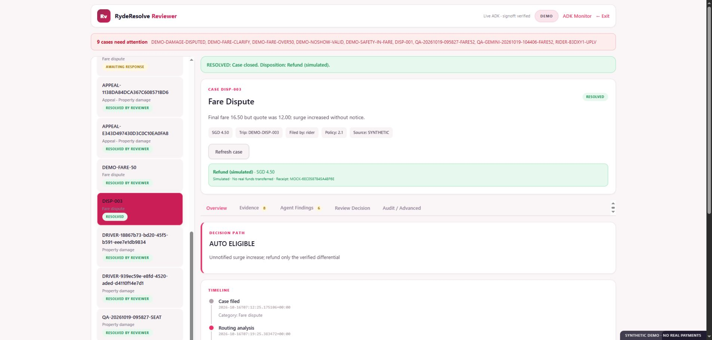
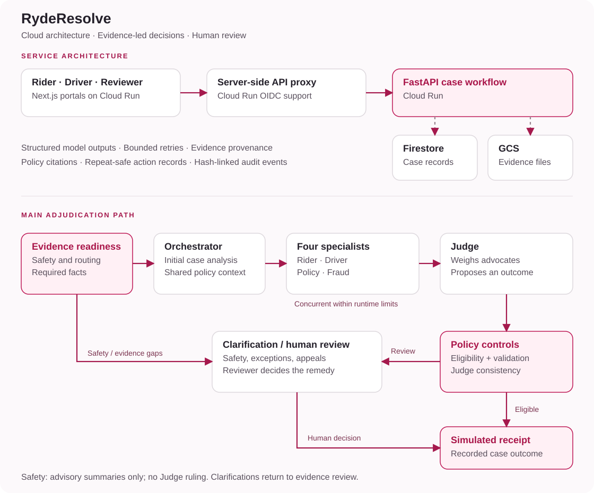

# RydeResolve

**Evidence-led dispute resolution for riders, drivers, and operations teams.**

RydeResolve brings both sides of a trip dispute, supporting evidence, and policy into one auditable resolution workflow. Six coordinated AI agents develop recommendations; a deterministic policy engine controls eligibility for automatic resolution and routes exceptions to human reviewers.

**[Explore the live demo](https://ryderesolve-web-oydodesgeq-as.a.run.app) · [Judge walkthrough](https://github.com/icedjaztea/200-OK-RydeResolve/blob/feat/three-role-frontend/docs/JUDGE_WALKTHROUGH.md) · [Architecture and operations](https://github.com/icedjaztea/200-OK-RydeResolve/blob/feat/three-role-frontend/docs/OPERATIONAL_LIMITS.md)**

*Source for this product walkthrough: [`feat/three-role-frontend`](https://github.com/icedjaztea/200-OK-RydeResolve/tree/feat/three-role-frontend). Use this branch for the current application and setup instructions.*



*The reviewer workbench brings the case queue, policy rationale, evidence, agent findings, and decision tools into one workspace.*

> The interactive demonstration uses synthetic trip data and simulated financial actions, with open role selection for judges.

## Why RydeResolve

Trip disputes bring together competing accounts, incomplete evidence, and rules that depend on context. RydeResolve gives operations teams a structured way to investigate each case, explain the outcome, and involve the right people when judgment is required.

| Capability | Value in the resolution workflow |
|---|---|
| Balanced advocacy | Dedicated rider and driver agents examine evidence from both perspectives. |
| Policy-grounded decisions | A 41-rule routing index locates relevant policy; exact rule IDs connect recommendations to the authoritative policy records. |
| Active clarification | Missing or conflicting evidence triggers a targeted question before a case proceeds. |
| Controlled automation | Deterministic eligibility checks and Judge consistency checks separate routine resolution from human review. |
| Appeals and reconsideration | Linked appeal cases preserve the original decision and evidence while inviting a counterparty response. |
| Traceable decisions | Evidence provenance, stored agent outputs, policy citations, and hash-linked events support review. |
| Reusable reviewed examples | Eligible reviewer decisions become case-specific guidance after checks, with rollback and exclusion of appealed source decisions. |

## Three connected experiences

| Experience | What you can do |
|---|---|
| [Rider portal](https://ryderesolve-web-oydodesgeq-as.a.run.app/rider) | Report a trip issue, upload evidence, answer clarification requests, track outcomes, and appeal a decision. |
| [Driver portal](https://ryderesolve-web-oydodesgeq-as.a.run.app/driver) | File reports with multiple attachments, retry failed uploads, respond to counterpart cases, and appeal decisions. |
| [Reviewer workbench](https://ryderesolve-web-oydodesgeq-as.a.run.app/reviewer) | Investigate evidence and agent findings, request information, classify intake, decide cases, and manage reviewed guidance. |

Rider and driver views filter cases to the selected demo identity and show recipient-specific updates. Trip selection links the reporting party and counterparty to the same case.

The [ADK Monitor](https://ryderesolve-web-oydodesgeq-as.a.run.app/monitor) replays stored execution outputs and traces. The [full dashboard](https://ryderesolve-web-oydodesgeq-as.a.run.app/lab) provides a reviewer-equivalent technical inspection view.

## Follow the case from evidence to outcome

1. **Intake and screening.** Capture the category, trip, parties, description, and attachments. Screen for safety concerns across categories and identify the applicable policy candidates.
2. **Evidence readiness.** Check required facts and contradictions. Ask for clarification when needed; party statements remain distinguishable from corroborated evidence.
3. **Coordinated analysis.** The Dispute Orchestrator runs first. Rider Advocate, Driver Advocate, Policy & Precedent, and Fraud & Bad-Faith run concurrently within the runtime's concurrency budget. The Judge runs last with the advocates' outputs and policy analysis.
4. **Independent policy control.** The Python policy engine calculates a candidate outcome and applies eligibility rules. Automatic resolution also requires valid agent outputs and a matching Judge disposition and amount.
5. **Resolution or review.** Eligible cases receive a simulated action receipt. Exceptions go to the reviewer with the evidence, policy rationale, and agent findings.
6. **Reconsideration and learning.** Parties can appeal resolved decisions. Eligible human-reviewed outcomes can become reusable case-specific guidance after source-decision and policy-regression checks.

Safety cases go to mandatory human review: advisory agents may summarize, while the Judge and automated ruling are skipped. Unclassified “Other” reports require reviewer classification; appeals require reviewer reconsideration.

## A guided demo for judges

Start in the **Reviewer workbench**. Select a case to inspect its saved result; use **Process** if it has not yet been processed.

| Case | What to look for |
|---|---|
| `DISP-003` | A SGD 12.00 quote and SGD 16.50 fare produce a SGD 4.50 differential. Inspect the policy rationale, agent findings, and simulated resolution receipt. |
| `DEMO-FARE-CLARIFY` | Missing notification evidence triggers a clarification request. Switch to Rider A to follow the response workflow. |
| `DEMO-SAFETY-IN-FARE` | Safety language within a fare complaint routes the case to mandatory human review. |
| A resolved case → appeal | Follow the original decision into a linked reconsideration case, counterparty response, and reviewer decision. |

The shared demo preserves existing cases and results. The [full walkthrough](https://github.com/icedjaztea/200-OK-RydeResolve/blob/feat/three-role-frontend/docs/JUDGE_WALKTHROUGH.md) includes navigation, expected checkpoints, and alternatives for cases already completed.

## Architecture and operational controls



[Mermaid workflow source](https://github.com/icedjaztea/200-OK-RydeResolve/blob/feat/three-role-frontend/docs/assets/architecture.mmd)

*The diagram shows the main adjudication path. Safety cases retain constrained advisory summaries; clarification responses return to evidence review.*

| Control | Implementation |
|---|---|
| Service separation | Independently containerized Next.js and FastAPI services; server-side proxy with configurable Google OIDC authentication. |
| Durable records | Firestore case, action, and precedent storage; content-addressed evidence objects in Cloud Storage. |
| Bounded AI execution | Structured output schemas, concurrency limits, request budgets, retries, configurable model fallback, and recorded model/latency metadata. |
| Conservative outcome routing | Invalid agent outputs or Judge-policy disagreement route the case to human review. |
| Repeat-safe operations | Create-only fixture seeding and deterministic keys for repeated identical simulated ledger actions. |
| Evidence and audit | File signature/size checks, evidence hashes and provenance, and SHA-256-linked case events. |

[Architecture and operations](https://github.com/icedjaztea/200-OK-RydeResolve/blob/feat/three-role-frontend/docs/OPERATIONAL_LIMITS.md) explains deployment configuration, integration boundaries, and the scaling roadmap.

## Run locally

Requires Python 3.11 and Node.js 22. These Bash commands start the local policy workflow with in-memory storage and offline agent outputs.

```bash
git clone --branch feat/three-role-frontend --single-branch https://github.com/icedjaztea/200-OK-RydeResolve.git
cd 200-OK-RydeResolve/backend
python3.11 -m venv .venv
source .venv/bin/activate
pip install -r requirements.txt
cp .env.example .env
python -m uvicorn app.main:app --reload --port 8000
```

In a second terminal, from the repository root:

```bash
cd frontend
cp .env.example .env.local
npm ci
npm run dev
```

Open [localhost:3000](http://localhost:3000). Fixture cases load at backend startup. See the [development guide](https://github.com/icedjaztea/200-OK-RydeResolve/blob/feat/three-role-frontend/docs/DEVELOPMENT.md) for PowerShell commands, Gemini configuration, and Cloud Run settings.

## Engineering validation

The repository includes backend tests for policy routing, case isolation, appeals, clarification, notification delivery, safety handling, output validation, and agent failure behavior. Frontend tests cover the API proxy, attachment handling, and supporting UI logic.

| Check | Command |
|---|---|
| Policy contract, backend tests, reference scenarios, and injection boundaries | `bash scripts/verify_all_local.sh` |
| Frontend tests | `cd frontend && npm test` |
| Frontend production build | `cd frontend && npm run build` |
| Live ADK scenario evaluation | `cd backend && PYTHONPATH=. python scripts/live_eval.py --cases DISP-003` with `AI_MODE=adk` and `APP_MODE=memory` |

Live evaluation writes scenario-level results, policy citations, timing, and agent diagnostics to `backend/reports/`. The [development guide](https://github.com/icedjaztea/200-OK-RydeResolve/blob/feat/three-role-frontend/docs/DEVELOPMENT.md#validation) describes how to reproduce each check.

## Documentation

- [Judge walkthrough](https://github.com/icedjaztea/200-OK-RydeResolve/blob/feat/three-role-frontend/docs/JUDGE_WALKTHROUGH.md) — follow representative cases through the product.
- [Architecture and operations](https://github.com/icedjaztea/200-OK-RydeResolve/blob/feat/three-role-frontend/docs/OPERATIONAL_LIMITS.md) — runtime controls, cloud configuration, integration, and scaling.
- [Development guide](https://github.com/icedjaztea/200-OK-RydeResolve/blob/feat/three-role-frontend/docs/DEVELOPMENT.md) — setup, environments, and validation commands.
- [API reference](https://github.com/icedjaztea/200-OK-RydeResolve/blob/feat/three-role-frontend/docs/API_REFERENCE.md) — case, evidence, appeal, and learning endpoints.
- [Policy review notes](https://github.com/icedjaztea/200-OK-RydeResolve/blob/feat/three-role-frontend/docs/POLICY_REVIEW_NOTES.md) — interpretation of the supplied challenge policy.
